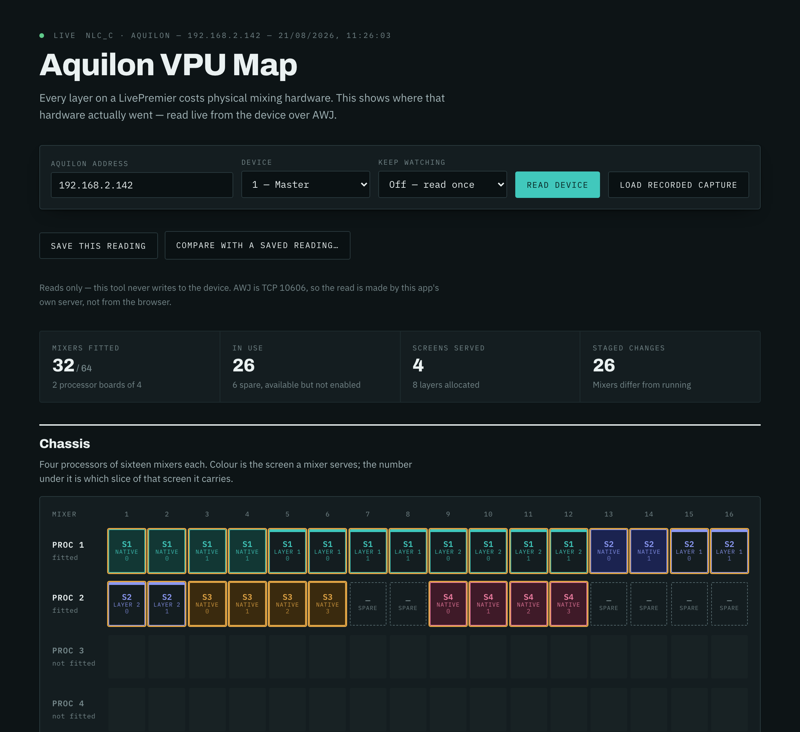
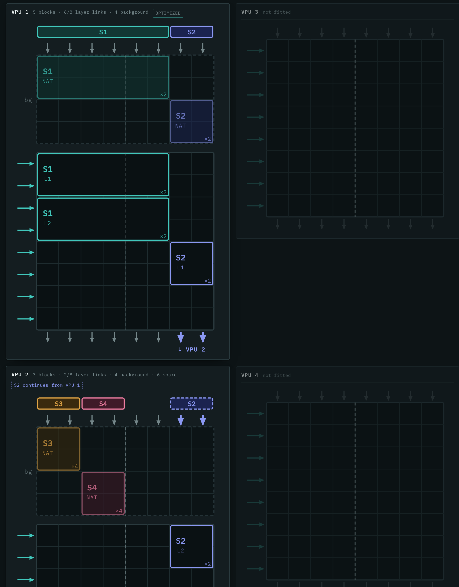

# Aquilon VPU Map

> **AI-assisted project. Status: field testing.** This codebase was created with
> [Claude](https://claude.com/claude-code) (Anthropic), directed and reviewed by a human
> author. **It's read a real Aquilon C end to end**, in three different configurations.
> Three of the four captures and the screenshots come from that box, and the second
> configuration corrected two things the first had made look settled. The fourth capture
> comes from a second chassis, which agreed with the model on 2026-09-09 (the details are
> under *The recorded captures*, below). Link setups, combined VPUs and a few other
> configurations are still untested, and the list is under *Working without a device*.

A map of how an Analog Way **LivePremier** has handed out its VPU mixers across
screens, layers and slices.

Every layer on a LivePremier costs physical mixing hardware. The device knows where
every bit of it went and will happily tell you, but the stock Web RCS only shows it a
panel at a time. This puts the whole chassis on one screen.



<!-- downloads:start -->

## Download

**[v1.3.1](https://github.com/stoatworks-labs/aquilon-vpu-map/releases/tag/v1.3.1)** — prebuilt for macOS, Windows and Linux. Pick your platform:

<details>
<summary><b>macOS</b> — Universal (Apple Silicon + Intel)</summary>

| Build | Download | Size |
| --- | --- | --- |
| Universal (Apple Silicon + Intel) · .dmg disk image | [`Aquilon.VPU.Map_1.3.1_universal.dmg`](https://github.com/stoatworks-labs/aquilon-vpu-map/releases/download/v1.3.1/Aquilon.VPU.Map_1.3.1_universal.dmg) | 3.8 MB |

</details>

<details>
<summary><b>Windows</b> — x64</summary>

| Build | Download | Size |
| --- | --- | --- |
| x64 · .exe installer | [`Aquilon.VPU.Map_1.3.1_x64-setup.exe`](https://github.com/stoatworks-labs/aquilon-vpu-map/releases/download/v1.3.1/Aquilon.VPU.Map_1.3.1_x64-setup.exe) | 1.6 MB |

</details>

<details>
<summary><b>Linux</b> — x64</summary>

| Build | Download | Size |
| --- | --- | --- |
| x64 · .deb package (Debian/Ubuntu) | [`Aquilon.VPU.Map_1.3.1_amd64.deb`](https://github.com/stoatworks-labs/aquilon-vpu-map/releases/download/v1.3.1/Aquilon.VPU.Map_1.3.1_amd64.deb) | 2.4 MB |
| x64 · .rpm package (Fedora/RHEL) | [`Aquilon.VPU.Map-1.3.1-1.x86_64.rpm`](https://github.com/stoatworks-labs/aquilon-vpu-map/releases/download/v1.3.1/Aquilon.VPU.Map-1.3.1-1.x86_64.rpm) | 2.4 MB |

</details>

Also in this release:

- [`Aquilon.VPU.Map_1.3.1_universal.app.tar.gz`](https://github.com/stoatworks-labs/aquilon-vpu-map/releases/download/v1.3.1/Aquilon.VPU.Map_1.3.1_universal.app.tar.gz) — macOS app bundle (updater archive; the .dmg is the install), 3.8 MB

All builds, checksums and release notes: [github.com/stoatworks-labs/aquilon-vpu-map/releases](https://github.com/stoatworks-labs/aquilon-vpu-map/releases).

macOS builds are signed and notarised and open normally. The Windows builds are unsigned, so SmartScreen warns once.

<!-- downloads:end -->

## The link grid



The manual draws a VPU as an **8×8 field of links**: eight layer links in from the
left, eight output links in through the top and out through the bottom (User Manual
v6.2 §5.5). It's a crosspoint field, and the view follows the manual's own figures,
read top to bottom the way an output link runs through it:

- **A row is one layer-capacity link, and it carries one layer.** Two layers never
  share a row. A layer is as tall as its capacity: dual link (up to 4K30) is 1, 4K60
  is 2, 5K60 is 4.
- **Columns belong to screens.** Each screen owns a contiguous run of output links, as
  wide as the number of outputs it uses, and screens sit side by side, so two
  four-output screens fill a VPU as links 1–4 and 5–8 (§5.5.4). That means all of a
  screen's layers start at the same link.
- **A layer's bar is continuous, and breaks at the centre line.** A layer spread over
  more than four output links takes another layer link and wraps onto it (§5.5.4),
  drawn with the manual's hook. A twelve-output screen's layer costs three links, over
  two VPUs (§5.5.5).
- **Optimized mode lifts that boundary for capacity-2 layers, and only those** (§5.5.6),
  so on an optimized VPU their bars run unbroken across the centre line.
- **A screen's native background isn't layer capacity.** It's reported like a layer
  and holds mixers, but it's drawn dimmed in a band of its own, **above** the field,
  and left out of the layer-link count. The native is the bottom of the stack, so it's
  the first thing on the output link, with layer 1 composited over it and the rest down
  the field.
- **A screen that runs out of mixers carries on in the next VPU.** Its next layer is
  allocated there on the *same* output links (the base capture has S3's native on
  VPU 1 and its layer 1 on VPU 2), so the link runs out of the bottom of one VPU and
  into the top of the next. Those two cards are **stacked**, the screen keeps the same
  columns on both, and the leaving and arriving arrows take the screen's colour, with
  `↓ VPU 2` under the leaving ones. (This isn't §5.5.5's *combined* VPU, which is a
  screen too wide for one; that's never been captured.)
- **The header names each link.** The screen bar over the columns is always there. On
  a live read, or a capture that carries the outputs (the fourth one does), two rows
  under it say which **region** and which **output plug** each link is (`R1`, `Out 5`),
  with the label, connector type and card in the tooltip. A 4K output is two links
  wide.

> **The columns come from the values, not the keys.**
>
> `usedOnOutPipe<k>: '<n>'` is a pair, and the two halves disagree. The key is the VPU
> pipe the mixer is wired to, and those are **interleaved**: a six-output screen's first
> mixer sits on pipes 1, 3, 5 and 7. The value is which of the *screen's* output links
> that pipe carries, and those are 1, 2, 3, 4: in order, contiguous, and what the manual
> draws. Read the keys as columns and you get a screen's layers on scattered links and
> a bar reaching across the centre line, which the hardware can't do.
>
> Nothing names the layer link (the row) at all. It doesn't need to: the rules above
> fix how many links each layer spends and forbid sharing, so the only thing left to
> choose is the order down the field, and that follows the device's own mixer
> allocation order.
>
> Nothing names the output behind a link either. The header gets that from the outputs
> themselves (each one says which screen and region it's in, and its capacity), dealt
> out over the screen's links **in output-number order**, two per 4K output. The paths
> and the sums hold on a real box (the fourth capture is lifted from a whole-store pull
> of 2026-09-09). The *order* is the only one the object model offers, and no box has
> confirmed it yet, because every screen read so far had one output. So it's checked
> against the screen's own `outputCount` and `usedOutputCapabilities`, and a screen
> whose outputs don't add up gets no header rather than a wrong one.
> [docs/CAPTURE-GUIDE.md](docs/CAPTURE-GUIDE.md) says what to do the next time a box
> is reachable.
>
> `$vpuLayer`, which looked like the reported grid, has **never reported anything**.
> On 6.2 hardware it answers `E12`, and so does `$pipe`; on a 6.1.60 Aquilon RS4 both
> are there with every scaler at its defaults. See
> [docs/HARDWARE-PROBE.md](docs/HARDWARE-PROBE.md).

## Working without a device

There's no Aquilon to read here any more, so the four recorded configurations in
[`data/`](data) are the whole ground truth. Every one is offered in the app's
**Recorded capture** picker, and the tests run off them.

```
node scripts/capture-config.mjs --report
```

audits them with no device needed: what each capture proves, and which questions
none of them can answer (a capacity-1 layer, an over-budget configuration, Cut &
Fill actually enabled, a screen too wide for one VPU). Each of those is a
configuration somebody with hardware has to build.

Still untested, then: **Link** setups (devices 2–4), capacities other than `4K` and
`5K`, combined VPUs and Cut & Fill. Optimized mode has been read once, in
`data/aquilon-c-optimized.json`, and the tests run off it. `capture-config.mjs --report`
lists what each open question needs and why it matters. If device time is short, do
capacity-1, over-budget and Cut & Fill first.

If you're that somebody, [docs/CAPTURE-GUIDE.md](docs/CAPTURE-GUIDE.md) is written
for you and assumes nothing: what to set up, what to run, and what it settles.
Recording one is

```
node scripts/capture-config.mjs <ip> --name capacity-1 --label "Dual-link layer"
```

which writes a redacted capture into `data/` and lists it in the picker. Like
everything else here, it only reads.

## What a VPU mixer is

A **VPU mixer** is the physical mixing and scaling resource the device allocates to a
(screen, layer) pair. An Aquilon has up to four processors of sixteen mixers, **64**
in total, though most chassis are part-populated.

A layer too wide for a single mixer is split across several, each carrying one
**slice**. That's why an eight-slice native layer can eat a whole processor board on
its own, and why counting layers never tells you whether a configuration will fit.

The device reports the map read-only, and keeps two copies of it: `current` (running)
and `new` (staged). This tool shows the running map and highlights anything the staged
one would change.

## Using it

**The desktop app** is the easiest way in: double-click it, nothing to install.
Grab it from [Releases](https://github.com/stoatworks-labs/aquilon-vpu-map/releases):
macOS, Windows or Linux, about 2 MB (nearer 4 MB for the universal macOS one)
because it uses the system WebView rather than bundling a browser.

> The macOS builds are signed and notarised and open normally. The Windows
> builds are unsigned, so SmartScreen warns once.

It's the same UI as the server build; the only difference is how it reaches the
switcher. On the desktop, Rust makes the AWJ connection directly.

### Or run the server

```bash
npm start
```

Then open <http://localhost:8531> and enter your Aquilon's address.

- **Screens are named the way you named them**, "S1 · Main LED", read from the
  device. Those names stay in the live view; they're not in the recorded captures
  or the profiler, which are both public.
- **Keep watching** re-reads on an interval. It stops itself if a read fails, and
  leaves the last good reading on screen rather than blanking on a network blip.
- **Save this reading** writes the whole thing to a file. **Compare with a saved
  reading** then diffs the live device against it and lists what moved. Take one
  before the show, compare during it.
- **Staged changes** shows what applying the device's own pending configuration
  would do, including link re-allocations that change no property at all.
- **Will it fit?** is answered from the device's own figures rather than guessed:
  output links spent, layers over outputs, links spare, and a warning if a screen
  is over budget. Screens in **Optimized mode** are marked, and the grid stops
  drawing the scaling-engine boundary on their VPU, because it doesn't apply
  there (§5.5.6).

[docs/ROADMAP.md](docs/ROADMAP.md) is what it can't do yet, and which capture
would unblock each one.

```bash
PORT=9000 AQUILON_IP=192.168.1.50 npm start
```

`AQUILON_IP` only sets the address the form starts on; the field is editable and the
browser remembers the last address you used.

### Docker

```bash
docker compose up -d
```

Or straight from the registry, which is what the Unraid Community Applications
template uses:

```bash
docker run -d --name aquilon-vpu-map -p 8531:8531 ghcr.io/stoatworks-labs/aquilon-vpu-map:latest
```

Bridge networking is enough: the app discovers nothing and only makes an outbound
connection to the address you type.

## Why it needs a server

AWJ is a raw TCP protocol on port **10606**. A browser tab can't open a TCP socket, so
the page can't talk to the device directly, however it's hosted. The app's own server
does the read and hands back JSON.

That's also why there's no useful "just open the HTML file" mode: without the server
you get the recorded capture and nothing else.

## Reads only

This tool **never writes to the device**. It sends AWJ `get` and nothing else, not
even the `Subscriptions` write that a push-based client would need. Every property it
reads is declared `readOnly` in the device's own model, so there's nothing here it
could change by accident.

If you want to be sure, `lib/awj.js` has no code path that emits `replace`.

## The recorded captures

Four real reads, picked to be different from each other: the first three from one
Aquilon C on 2026-08-21, the fourth from a second chassis on 2026-09-09.

- `data/aquilon-c-snapshot.json`: four screens, one layer each, every mixer `4K`,
  with one eight-slice native layer. **Load recorded capture** shows this one.
- `data/aquilon-c-6output-5k.json`: the same chassis reconfigured, with S1 a
  **six-output** screen with native plus two layers, and S2 a **5K** layer.
- `data/aquilon-c-optimized.json`: S1 with three layers over three outputs,
  reporting `isOptimized`, plus the per-screen resource status.
- `data/aquilon-c-dual-outputs.json`: the second chassis, lifted from its whole-store
  pull. Three single-output screens on dual-link HDMI outputs, and the only capture
  that carries the outputs.

The tests run against all four, because the first on its own supports assumptions the
second disproves, the big one being that a slice identifies one mixer. It doesn't: a
layer spread over more than four output links is carried by a second mixer on
different links, so a six-output screen reads as slices `[0,0,1,1]`.

**Verified against a second chassis, 2026-09-09.** `scripts/probe-hardware.mjs`,
`scripts/profile-vpu.mjs` and `scripts/capture-config.mjs` were all run against a
different Aquilon C (`NLC_C`, firmware 6.2.73) and agreed with the recorded model: 32
mixers fitted, 24 enabled, `channel` still `[0]` on every one, slices `[0,1,2,3]`,
capability `4K`. **`$vpuLayer` is still missing on 6.2.73** (it answers `E12` on
hardware and exists but is empty on the simulator), so the link grid still has to be
worked out from `mixerAllocation.usedOnOutPipe1..8`, which is what this repo does.
Re-run `probe-hardware.mjs` after any firmware update; that's what it's for.

The host each one came from is redacted, and screen names are stripped, because those
are show data. A test fails if a capture ever grows them back. Nothing else is edited.

## Supported devices

Built for **LivePremier** (Aquilon). Alta 4K and Midra 4K speak AWJ too, and the
client here will connect to them, but the VPU mixer map is a LivePremier structure
and other platforms answer `E12` for it. The app tells you so rather than showing an
empty chassis.

**Firmware 6.1.x has no VPU map.** An Aquilon RS4 on 6.1.60, three screens on air,
answers `E12` for `$vpuMixer` (2026-10-16): it simply doesn't say how its mixers are
allocated. What it does say is each screen's layers by size and, in the staged
configuration, how many more of each size the box has room for — so that's what the
app shows, under a banner that names the box and its firmware. The room is the box's
one pool seen from each screen, so every screen shows the same figure.

**Some simulators have no VPU map either**, and the same E12 looks identical on the
wire. So the app doesn't guess from the shape of the answer: it asks the device
whether it's a simulator (`isSimulated`) and which firmware it runs
(`version/@props/updater`), and words the banner from that. It used to call every
such box a simulator, which is the one wrong thing to tell someone standing in front
of a live switcher.

Which collections a box carries depends on its firmware, not on whether it's
hardware. A 6.2.73 Aquilon C has `vpuMixerList` and neither `pipeList` nor
`vpuLayerList`; a 6.1.60 RS4 and the 6.2.73 simulator of August had the opposite. Say
which firmware anything was checked on.

## Paths

Firmware 6.2, verified on hardware. The collection segment is `$vpuMixer`, camelCase;
`$vpu-mixer` and `$mixer` both answer `E12`.

```
DeviceObject/preconfig/resources/{current|new}/status/mapping
  /$device/@items/<1-4>                       1 = master, 2-4 = Link followers
  /$vpuMixer/@items/PROC_<1-4>_MIXER_<1-16>
    /@props/isAvailable                       fitted?
    /@props/isEnabled                         in use?
    /@props/usedInScreen                      S1..S24
    /@props/usedInLayer                       NATIVE, then 1..256
    /@props/slice                             0..8
    /@props/capability                        OFF DUAL 4K 3 5K 5 6 7 8K
    /@props/channel                           0 on every mixer seen so far;
                                              assumed to index the Link device
    /@props/seamlessCapa
    /@props/cutnfillCapa                      OFF, or the capability it doubles
    /mixerAllocation/@props/usedOnOutPipe{1-8} which output link, NONE..64
    /$scaler/@items/{A,B}/@props/{memoryFill,memoryCut}  SM1..SM8
```

AWJ can't enumerate: every container read returns `{}`. See [AGENTS.md](AGENTS.md) for
where the model came from and how to recover the rest of it.

## Profiling your own device

If you've got a LivePremier, a profile of how *your* box has allocated its VPU mixers
is properly useful. The model here was built from one Aquilon C, and every
configuration that differs from it teaches me something.

```bash
node scripts/profile-vpu.mjs 192.168.1.50 --note "Aquilon RS4, 3 screens"
```

One file, no dependencies, Node 18+. **It only reads.** There's a single line in it
that sends anything to the device, and it's hard-coded to AWJ's `get` verb; the script
says so at the top and invites you to check. It takes about five seconds and is safe on
a live system, though you may as well run it between shows.

It writes `vpu-profile-<model>-<timestamp>.json` and prints a summary. The file records
structure only: screens appear as `S1`..`S24` and mixers as `PROC_n_MIXER_n`. **No
addresses, serial numbers, device names, screen names or labels**, so there's nothing
in it that identifies you, your client or your show. Read it, then attach it to an
issue if you're happy to share.

The most useful ones are configurations unlike the ones already recorded: mixed
capabilities (`DUAL`, `8K`), **Link** setups with more than one device, Cut & Fill,
or a screen spread over more than 8 outputs. The script tells you which
of these your box has.

## Probing hardware

```bash
node scripts/probe-hardware.mjs <ip> --out probe-out
```

Read-only. Captures the device's whole `preconfig/resources` subtree, sweeps for
paths this tool doesn't use yet, and reports whether the `$vpuLayer` link grid is
populated. See [docs/HARDWARE-PROBE.md](docs/HARDWARE-PROBE.md).

## Tests

```bash
npm test
```

No dependencies, no build step. Node 18+.

<!-- attributions:start -->
This project is built on other people's work — see [ATTRIBUTIONS.md](ATTRIBUTIONS.md).
<!-- attributions:end -->

## Licence

MIT, see [LICENSE](LICENSE).

Not affiliated with Analog Way. "LivePremier", "Aquilon" and "Alta" are their marks.
